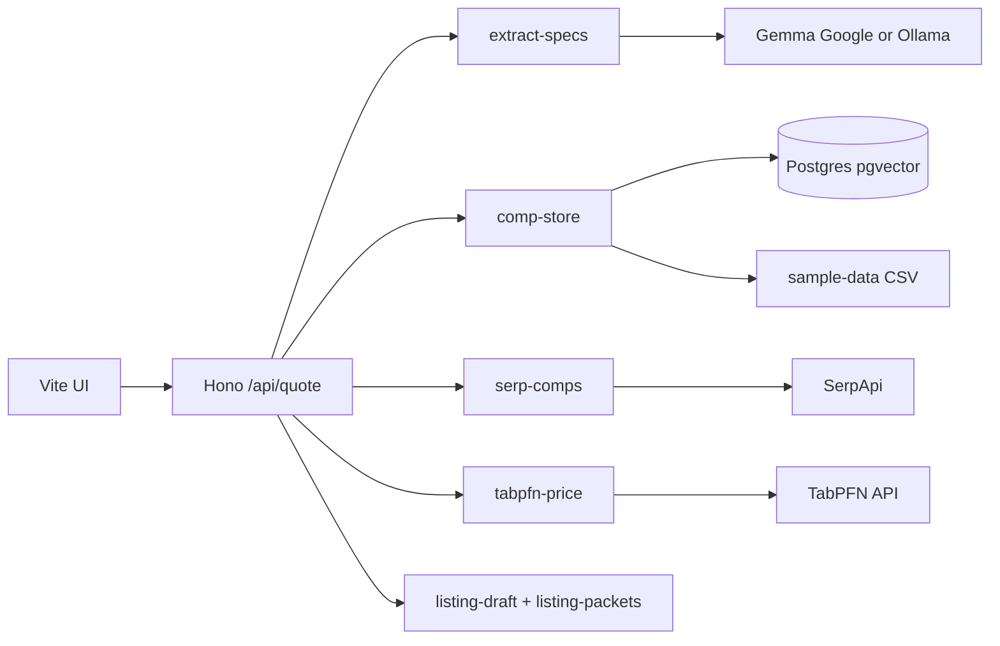

# Local setup & API keys

Price Wire runs as one Node app (`npm run dev` → `http://localhost:8787`). Integrations are **optional layers**; without keys you still get sample comps, heuristic spec extraction, and median-based pricing.

## Tiers

| Tier | What you get | Keys / services |
| --- | --- | --- |
| **0 — Offline demo** | UI + sample CSV comps + heuristic “Gemma off” extraction + median price | None |
| **1 — Smarter extraction** | Gemma parses messy titles into brand/model/storage | Google AI **or** Ollama |
| **2 — Better comps** | Pooled comps in Postgres + vector search | Tiger Data `DATABASE_URL` + one-time seed |
| **3 — Live market** | Fresh eBay-style snippets merged into comps | SerpApi |
| **4 — ML price band** | TabPFN prediction instead of median | TabPFN API |
| **5 — Production trace** | Sentry spans on `/api/quote` | Sentry DSN |

Start at tier 0, then add keys one at a time and watch the status line on the form (**Gemma · TabPFN · Tiger · SerpApi**).

---

## Keys to collect

Copy `.env.example` → `.env` in the repo root.

| Variable | Service | Where to get it | Used for |
| --- | --- | --- | --- |
| `GOOGLE_GENERATIVE_AI_API_KEY` | [Google AI Studio](https://aistudio.google.com/apikey) | API key | Gemma extraction via cloud |
| `OLLAMA_BASE_URL` | [Ollama](https://ollama.com) | Local install, default `http://127.0.0.1:11434` | Gemma extraction without Google key |
| `GEMMA_MODEL` | Ollama | Pull model: `ollama pull gemma2:2b` | Model name for local Gemma |
| `DATABASE_URL` | [Tiger Data](https://www.tigerdata.com/) (or any Postgres + pgvector) | Connection string from your DEV service | Comp store + hybrid search |
| `SERPAPI_KEY` | [SerpApi](https://serpapi.com/) | Dashboard API key | Live marketplace search results |
| `TABPFN_API_KEY` | [Prior Labs / TabPFN](https://www.priorlabs.ai/) | Platform API key | Tabular price prediction |
| `SENTRY_DSN` | [Sentry](https://sentry.io/) | Project DSN | Optional tracing |
| `PORT` | — | Default `8787` | HTTP port |

You do **not** need all of them. Tier 0 is valid for UI and listing-draft testing.

---

## Commands

```bash
cd price-wire
cp .env.example .env
npm install
```

### Tier 0 (no keys)

Use an empty `.env` or leave integration keys blank. If `OLLAMA_BASE_URL` is set but Ollama is not running (or the model is not pulled), extraction falls back to heuristics—you may see a one-line warning in `npm run smoke`; that is still tier 0.

```bash
npm run smoke          # pipeline without server
npm run dev            # build web + API on :8787
```

Open `http://localhost:8787`, enter a title and condition, submit.

### Tier 1 — Gemma (pick one)

**Option A — Ollama (local, no Google key)**

```bash
# Install Ollama, then:
ollama pull gemma2:2b
```

In `.env`:

```env
OLLAMA_BASE_URL=http://127.0.0.1:11434
GEMMA_MODEL=gemma2:2b
```

Leave `GOOGLE_GENERATIVE_AI_API_KEY` empty. Restart `npm run dev`. Health should show **Gemma** on.

**Option B — Google AI**

```env
GOOGLE_GENERATIVE_AI_API_KEY=your_key
```

Restart dev server. Cloud Gemma is used when the key is set (see `extract-specs.ts` for precedence).

### Tier 2 — Tiger / Postgres

1. Create a **DEV** Postgres service with **pgvector** enabled (Tiger MCP or Tiger console).
2. Set `DATABASE_URL` in `.env` (Tiger or any Postgres with pgvector).

3. Apply schema and seed (**do not** run `sql/schema.sql` in PowerShell or bash — that file is SQL, not a shell script):

```bash
npm run db:schema
npm run seed
```

Or paste `sql/schema.sql` into the Tiger SQL console, then run `npm run seed` only.

**SSL error** (`SELF_SIGNED_CERT_IN_CHAIN`): add `DATABASE_SSL_INSECURE=true` to `.env` (common with Tiger in local dev), then rerun `npm run db:schema` and `npm run seed`.

**Quotes fail with a bad `DATABASE_URL`:** Until Tiger is fixed, **comment out or remove `DATABASE_URL`** in `.env` so the app uses bundled sample sales only (SerpApi + Google AI still work). A broken URL used to crash quotes after SerpApi; that is now handled, but removing it avoids slow failed DB attempts each request.

The form status chip **Sale prices** shows **online** when the DB answers; otherwise **offline — sample sales**. URL alone is not enough—run `npm run db:schema` then `npm run seed`.

### Tier 3 — SerpApi

```env
SERPAPI_KEY=your_key
```

Restart server. With a key set, **every quote** calls SerpApi: **Google Shopping** (retail/store listings) plus **eBay** (used marketplace), merged into the similar-sales table (`serpapi` in **Data**, store name in **Platform**).

### Tier 4 — TabPFN

```env
TABPFN_API_KEY=your_key
```

When comps exist, price prediction prefers TabPFN; otherwise median fallback (method label in the UI).

### Tier 5 — Sentry

```env
SENTRY_DSN=https://...@....ingest.sentry.io/...
```

The app uses **`@sentry/node`** on the API server (`src/lib/sentry.ts`). You do **not** need `@sentry/react` unless you add browser error reporting later.

Trigger a quote and inspect the `pricing.run` span in Sentry.

---

## Verify integrations

```bash
curl -s http://localhost:8787/api/health | jq
```

```bash
curl -s -X POST http://localhost:8787/api/quote \
  -H "Content-Type: application/json" \
  -d "{\"title\":\"Sony WH-1000XM5 black like new\",\"condition\":\"like_new\"}" | jq '.suggested_price,.listing_setup.default_platform'
```

```bash
npm run smoke
```

---

## What connects to what



No separate microservices to run except **Ollama** (if you choose local Gemma). Everything else is HTTP APIs from the Node process.

---

## Deploy

See [DEPLOY.md](./DEPLOY.md) for Render env vars (same keys as above).
